*[Leia em português](README.md)*

[GitHub](https://github.com/hcristosm) · [LinkedIn](https://www.linkedin.com/in/mateus-leptokarydis/) · [Lattes](https://lattes.cnpq.br/4735526517901649) · [ORCID](https://orcid.org/0009-0000-5877-5763) · [Email](mailto:hcristosm@gmail.com)

Geologist, MSc in Geosciences from IG-UNICAMP, who got curious about code. I have mapped geological risk areas myself, and these days most of my time goes into two sibling projects built on Brazil's public risk data:

- **[ORCA](https://github.com/hcristosm/ORCA)** puts the geological risk sectors and the rain that fell on them on the same map, updated every day. [Live dashboard](https://hcristosm.github.io/ORCA/).
- **[BELUGA](https://github.com/hcristosm/BELUGA)** gathers the risk maps that states and cities make on their own into one standard dataset, so ORCA can see past the federal survey.

## about

I write mostly Python. On the geo side, GeoPandas and GeoPackage over public data, like the CPRM/SGB risk sectors and the city risk maps behind ORCA and BELUGA. On the vision side, OpenCV pipelines (Canny edges, contour filters, frame by frame tracking) from my master's research on slope monitoring. Lately also some reverse engineering, reading a vendor's Windows tool so my keyboard works on Linux. I keep tests where the logic is worth it and check results against ground truth or an independent baseline like SAM 2, because I do not trust my own numbers until something else agrees with them. Still learning a lot of this as I go.

## how I work

I code with LLM agents most days. Claude Code writes a good part of the code, and Cline running local models like Qwen2.5-Coder through Ollama handles the repetitive edits. I bring the problem, the domain knowledge and the decisions, write the spec and the constraints, then read the diff and run the tests before anything gets committed, and change course when the result does not match what the data says. I still get things wrong this way. I would rather tell you how the code got written than have you assume, and if something in these repos is broken, it is on me either way.

## geological risk: ORCA and BELUGA

CPRM/SGB, the Brazilian geological survey, maps risk sectors in about 1,600 municipalities. São Paulo, Rio de Janeiro, Belo Horizonte and Recife have none of them: their maps, when they exist, belong to the city civil defense, a state agency or a research institute, each in its own format. BELUGA collects those maps next to the CPRM ones in a single schema, and ORCA crosses the result with rain.

<samp>CPRM/SGB + state and city maps → BELUGA → ORCA → rain over each sector, on a map</samp>

**[ORCA](https://github.com/hcristosm/ORCA)** &nbsp;·&nbsp; <samp>python, geopandas, geopackage, typer, leaflet, chart.js, github actions, pytest</samp> &nbsp;·&nbsp; [live dashboard](https://hcristosm.github.io/ORCA/)

ORCA crosses the geological risk sectors that CPRM/SGB publishes for all 27 states with the rain that fell on each one. Rain is hourly Open-Meteo per sector, summed over 24h and 72h, with a forecast of where alerts are heading in the next 72h, and one national query grid, sized by binary search, keeps the whole country inside the free daily request budget. The dashboard is static HTML and JS on GitHub Pages, rebuilt every day and installable as an app. On a phone it opens on a "near me" tab: it takes your location, says whether that spot may go into alert, lists the sectors within 10 km, and still opens with no signal, showing the last reading and its time. On a bigger screen there is risk grade drawn as hatching like a geological map, a ruler with every sector against a threshold you drag, live INMET warnings, radar and lightning layers, CSV and PDF export, and your own area (GeoJSON, KML or shapefile) processed without leaving the browser. A tutorial tab lists the thresholds real civil defense agencies use. Sectors refresh monthly and rain daily, in separate workflows with guards that fail the run instead of publishing a half empty map, and 175 tests run in CI. Rain is modeled, not gauged, and the 100mm default comes from the literature, not an official calibration. A side project on public data, not a warning system anyone should rely on.

**[BELUGA](https://github.com/hcristosm/BELUGA)** &nbsp;·&nbsp; <samp>python, geopandas, shapely, arcgis rest, yaml, json schema, leaflet, pytest</samp> &nbsp;·&nbsp; <samp>new</samp>

BELUGA is a catalog and a dataset. The catalog keeps every risk mapping source I find, one YAML file each, with the agency, the access format, the license and whether the access was confirmed. The pipeline collects the open ones, keeps the raw payload with its sha256, and normalizes every sector into the same columns ORCA already reads, with its provenance attached. The first collection, on 2026-11-21, has 21,429 sectors in 27 states: CPRM plus the city maps of Juiz de Fora, Belo Horizonte, Recife, Contagem, Suzano and Congonhas. A sector that overlaps a CPRM one is flagged, not dropped, and the differences that matter are written down: Belo Horizonte's map is from 1996 and has no risk grade, Recife and Contagem are points, not polygons. Collection is polite, with an identified user agent, robots.txt read before the first request and a minimum interval per host, and it inherits ORCA's guards: a source that goes down, answers with an HTML page or loses more than 10% of its sectors fails the run instead of shrinking the dataset. 83 tests, every network call mocked. Coverage is still small, since São Paulo, Rio de Janeiro and Salvador have no confirmed open source yet. Next, ORCA reads its sectors from BELUGA instead of straight from CPRM.

If you know an open risk map from a state or a city, that is the most useful thing you can send me: open an issue on [BELUGA](https://github.com/hcristosm/BELUGA/issues) or follow the [guide to add a source](https://github.com/hcristosm/BELUGA/blob/main/CONTRIBUTING.md).

## other projects

**[Videomonitoramento-de-encostas](https://github.com/hcristosm/Videomonitoramento-de-encostas)** &nbsp;·&nbsp; <samp>python, opencv, sam 2, dbscan, jupyter</samp>

My master's research at IG-UNICAMP: can a cheap camera catch the moment a vegetated slope on the Serra do Mar starts moving? An OpenCV pipeline runs frame by frame on a plain CPU: Gaussian blur, Canny edges and morphological closing, a circularity filter to find the 40mm target balls, and nearest distance tracking with a 4px search lock so targets do not get swapped when something blocks the view. As an independent check, Meta SAM 2 runs zero shot over the same footage every 30 seconds, DBSCAN groups its masks and a separate script scores them against ground truth, on a day and a night series. The notebooks run locally or on Colab, and 19 of the 889 recorded videos are public. Size is what makes it plausible in the field: 30 minutes of video is 113MB, the target coordinates come down to about 20MB of CSV. One site and a limited set of runs, so it argues for feasibility, not much more.

**[ak820-linux](https://github.com/hcristosm/ak820-linux)** &nbsp;·&nbsp; <samp>python, pyside6, pillow, hid, reverse engineering</samp>

My keyboard, an AJAZZ AK820 Pro, only ships with a Windows configurator, so I took that apart to get it working on Linux. The HID protocol came out of the vendor's DeviceDriver.exe: 64 byte feature reports carry the commands, 4096 byte output reports carry the screen as RGB565 frames. It runs the 20 built-in lighting effects, paints per-key colors, uploads an image or a GIF of up to 140 frames to the 128x128 screen and syncs its clock. Music mode makes the keys react to whatever the PC is playing, in four styles from a level meter to a beat pulse. A CLI plus a PySide6 GUI with saved profiles, self-checks that run without the keyboard, and an installer that sets up the udev rule and an app menu entry. Wired USB only; no key remapping, macros or wireless. Unofficial, not affiliated with AJAZZ.
