<picture>
  <source media="(prefers-color-scheme: dark)" srcset="./header-en-dark.svg">
  
</picture>

*[Leia em português](README.md)*

[GitHub](https://github.com/hcristosm) · [LinkedIn](https://www.linkedin.com/in/mateus-leptokarydis/) · [Lattes](https://lattes.cnpq.br/4735526517901649) · [ORCID](https://orcid.org/0009-0000-5877-5763) · [Email](mailto:hcristosm@gmail.com)

Geologist, MSc in Geosciences from IG-UNICAMP, who got curious about code. I have mapped geological risk areas myself, and these days most of my time goes into two sibling projects built on Brazil's public risk data:

- **[ORCA](https://github.com/hcristosm/ORCA)** puts the geological risk sectors and the rain that fell on them on the same map, updated every day. [Live dashboard](https://hcristosm.github.io/ORCA/).
- **[BELUGA](https://github.com/hcristosm/BELUGA)** gathers the risk maps that states and cities make on their own into one standard dataset, so ORCA can see past the federal survey.

## about

I write mostly Python. On the geo side, GeoPandas and GeoPackage over public data, like the CPRM/SGB risk sectors and the city risk maps behind ORCA and BELUGA. On the vision side, OpenCV pipelines (Canny edges, contour filters, frame by frame tracking) from my master's research on slope monitoring. Lately also some reverse engineering, reading a vendor's Windows tool so my keyboard works on Linux. I keep tests where the logic is worth it and check results against ground truth or an independent baseline like SAM 2, because I do not trust my own numbers until something else agrees with them. Still learning a lot of this as I go.

## how I work

I code with LLM agents most days. Claude Code writes a good part of the code, and Cline running local models like Qwen2.5-Coder through Ollama handles the repetitive edits. I bring the problem, the domain knowledge and the decisions, write the spec and the constraints, then read the diff and run the tests before anything gets committed, and change course when the result does not match what the data says. I still get things wrong this way. I would rather tell you how the code got written than have you assume, and if something in these repos is broken, it is on me either way.

## geological risk: ORCA and BELUGA

CPRM/SGB, the Brazilian geological survey, publishes geological risk sectors for many municipalities, but not for all of them. Many cities have their own maps, made by the civil defense, a state agency or a research institute, each in its own format. BELUGA brings those maps together with the CPRM ones in a single schema, and ORCA crosses the sectors with rain.

<samp>CPRM/SGB + state and city maps → BELUGA → ORCA → rain over each sector, on a map</samp>

**[ORCA](https://github.com/hcristosm/ORCA)** &nbsp;·&nbsp; <samp>python, geopandas, leaflet, github actions</samp> &nbsp;·&nbsp; [live dashboard](https://hcristosm.github.io/ORCA/)

<picture>
  <source media="(prefers-color-scheme: dark)" srcset="./orca-dark.svg">
  
</picture>

Show where heavy rain is falling on a known geological risk sector, putting on one map two pieces of public information that rarely appear together. ORCA adds up the recent and forecast rain over each sector and highlights the ones above a threshold you choose, with reference thresholds used by civil defense agencies. A Python pipeline updates the data every day and builds static files; the dashboard runs straight in the browser, with no server, and installs as an app on a phone, where it answers whether the place you are standing may go into alert. Rain is modeled, not gauged: ORCA is for following and studying, not a replacement for official warnings.

**[BELUGA](https://github.com/hcristosm/BELUGA)** &nbsp;·&nbsp; <samp>python, geopandas, yaml</samp>

<picture>
  <source media="(prefers-color-scheme: dark)" srcset="./beluga-dark.svg">
  
</picture>

Make the risk maps produced outside CPRM, by states and cities, usable alongside the CPRM ones. BELUGA keeps a catalog of those sources, with the agency, access format and license of each, collects the ones with open data and normalizes the sectors into a common schema, keeping track of where each one came from. A sector that overlaps a CPRM one is flagged, not dropped, and the differences between products are written down. Collection is gentle with the public servers it reads from, and a source that fails never shrinks the dataset silently. The dataset grows with each new source and is built to feed ORCA.

If you know an open risk map from a state or a city, that is the most useful thing you can send me: open an issue on [BELUGA](https://github.com/hcristosm/BELUGA/issues) or follow the [guide to add a source](https://github.com/hcristosm/BELUGA/blob/main/CONTRIBUTING.md).

## other projects

**[Videomonitoramento-de-encostas](https://github.com/hcristosm/Videomonitoramento-de-encostas)** &nbsp;·&nbsp; <samp>python, opencv, sam 2</samp>

My master's research at IG-UNICAMP: finding out whether a low-cost camera can catch the moment a vegetated slope starts to move. Targets placed on the slope are tracked frame by frame by an OpenCV pipeline that runs on a plain CPU, and the result is checked independently with Meta's SAM 2 against ground truth. The notebooks run locally or on Colab. It is a feasibility study at a single site, not a system ready for the field.

**[ak820-linux](https://github.com/hcristosm/ak820-linux)** &nbsp;·&nbsp; <samp>python, pyside6, hid</samp>

Use the AJAZZ AK820 Pro keyboard on Linux, when the only official configurator is for Windows. The protocol came from reverse engineering the vendor's tool, and the project drives the lighting effects, per-key colors, the built-in screen (image, GIF and clock) and a mode where the keys react to music. It has a command line, a GUI and an installer that sets up the permissions. Unofficial, not affiliated with AJAZZ.
