<picture>
  <source media="(prefers-color-scheme: dark)" srcset="./header-dark.svg">
  
</picture>

# Mateus Leptokarydis

Geólogo pela UNICAMP · Mestre em Geociências pelo IG-UNICAMP

*[Read in English](README.en.md)*

[GitHub](https://github.com/hcristosm) · [LinkedIn](https://www.linkedin.com/in/mateus-leptokarydis/) · [Lattes](https://lattes.cnpq.br/4735526517901649) · [ORCID](https://orcid.org/0009-0000-5877-5763) · [Email](mailto:hcristosm@gmail.com)

Geólogo que ficou curioso com código. Já mapeei área de risco geológico em campo, e hoje a maior parte do meu tempo vai para dois projetos irmãos feitos com os dados públicos de risco do Brasil:

- **[ORCA](https://github.com/hcristosm/ORCA)** mostra no mesmo mapa os setores de risco geológico e a chuva que caiu sobre eles, atualizado todo dia. [Dashboard ao vivo](https://hcristosm.github.io/ORCA/).
- **[BELUGA](https://github.com/hcristosm/BELUGA)** reúne os mapeamentos de risco que estados e prefeituras fazem por conta própria numa base padronizada, para o ORCA enxergar além do levantamento federal.

## sobre

Escrevo quase tudo em Python. No lado geo, GeoPandas e GeoPackage sobre dado público, como os setores de risco da CPRM/SGB e os mapeamentos municipais por trás do ORCA e do BELUGA. No lado de visão computacional, pipelines em OpenCV (bordas Canny, filtros de contorno, rastreamento quadro a quadro) da minha pesquisa de mestrado sobre monitoramento de encostas. Ultimamente também um pouco de engenharia reversa, lendo a ferramenta de Windows de um fabricante para o meu teclado funcionar no Linux. Escrevo testes onde a lógica justifica e confiro os resultados contra o dado de referência ou contra um modelo independente como o SAM 2, porque não confio nos meus números até outra coisa concordar com eles. Ainda estou aprendendo boa parte disso no caminho.

## como eu trabalho

Programo com agentes de LLM quase todo dia. O Claude Code escreve boa parte do código, e o Cline rodando modelos locais como o Qwen2.5-Coder pelo Ollama cuida das edições repetitivas. Eu trago o problema, o conhecimento do domínio e as decisões, escrevo a especificação e as restrições, depois leio o diff e rodo os testes antes de qualquer commit, e mudo de rumo quando o resultado não bate com o que o dado diz. Ainda erro desse jeito. Prefiro contar como o código foi escrito a deixar você supor, e se alguma coisa nestes repositórios estiver quebrada, a responsabilidade é minha de qualquer forma.

## risco geológico: ORCA e BELUGA

A CPRM/SGB, o Serviço Geológico do Brasil, publica setores de risco geológico para muitos municípios, mas não para todos. Muitas cidades têm o próprio mapeamento, feito pela defesa civil, por um órgão estadual ou por um instituto de pesquisa, cada um num formato. O BELUGA junta esses mapeamentos aos da CPRM num esquema único, e o ORCA cruza os setores com a chuva.

<samp>CPRM/SGB + mapeamentos estaduais e municipais → BELUGA → ORCA → chuva sobre cada setor, num mapa</samp>

**[ORCA](https://github.com/hcristosm/ORCA)** &nbsp;·&nbsp; *Open Risk and Catastrophe Aggregator* &nbsp;·&nbsp; <samp>python, geopandas, leaflet, github actions</samp> &nbsp;·&nbsp; [dashboard ao vivo](https://hcristosm.github.io/ORCA/)

<picture>
  <source media="(prefers-color-scheme: dark)" srcset="./orca-dark.svg">
  
</picture>

Mostrar onde está chovendo forte sobre um setor de risco geológico conhecido, juntando num só mapa duas informações públicas que quase nunca aparecem juntas. O ORCA soma a chuva recente e a prevista sobre cada setor e destaca os que passam de um limiar que você escolhe, com referências de limiares usados por defesas civis. Um pipeline em Python atualiza os dados todo dia e gera arquivos estáticos; o dashboard roda direto no navegador, sem servidor, e se instala como app no celular, onde responde se o lugar em que você está pode entrar em alerta. A chuva é modelada, não medida em pluviômetro: o ORCA serve para acompanhar e estudar, não substitui o alerta oficial.

**[BELUGA](https://github.com/hcristosm/BELUGA)** &nbsp;·&nbsp; *Brazilian External Landslide & Unmapped Geohazard Archive* &nbsp;·&nbsp; <samp>python, geopandas, yaml</samp>

<picture>
  <source media="(prefers-color-scheme: dark)" srcset="./beluga-dark.svg">
  
</picture>

Fazer os mapeamentos de risco produzidos fora da CPRM, por estados e prefeituras, poderem ser usados junto com os dela. O BELUGA mantém um catálogo dessas fontes, com o órgão, o formato de acesso e a licença de cada uma, coleta as que têm dado aberto e padroniza os setores num esquema comum, guardando a origem de cada um. Setor que coincide com um da CPRM é marcado, não descartado, e as diferenças entre os produtos ficam registradas. A coleta respeita os servidores públicos de onde lê, e uma fonte que falha não encolhe a base em silêncio. A base cresce a cada fonte nova e foi feita para alimentar o ORCA.

Se você conhece um mapeamento de risco aberto de um estado ou de uma prefeitura, é a coisa mais útil que pode me mandar: abra uma issue no [BELUGA](https://github.com/hcristosm/BELUGA/issues) ou siga o [guia para adicionar uma fonte](https://github.com/hcristosm/BELUGA/blob/main/CONTRIBUTING.md).

## outros projetos

**[Videomonitoramento-de-encostas](https://github.com/hcristosm/Videomonitoramento-de-encostas)** &nbsp;·&nbsp; <samp>python, opencv, sam 2</samp>

A minha pesquisa de mestrado no IG-UNICAMP: saber se uma câmera de baixo custo consegue detectar o momento em que uma encosta vegetada começa a se mover. Alvos instalados na encosta são rastreados quadro a quadro por um pipeline em OpenCV que roda numa CPU comum, e o resultado é conferido de forma independente com o SAM 2, da Meta, contra o dado de referência. Os notebooks rodam localmente ou no Colab. É um estudo de viabilidade num único local, não um sistema pronto para campo.

**[ak820-linux](https://github.com/hcristosm/ak820-linux)** &nbsp;·&nbsp; <samp>python, pyside6, hid</samp>

Usar no Linux o teclado AJAZZ AK820 Pro, que só tem configurador oficial para Windows. O protocolo veio da engenharia reversa da ferramenta do fabricante, e o projeto controla os efeitos de luz, as cores por tecla, a tela embutida (imagem, GIF e relógio) e um modo em que as teclas reagem à música. Tem linha de comando, interface gráfica e um instalador que configura as permissões. Não oficial, sem vínculo com a AJAZZ.
