*[Read in English](README.en.md)*

[GitHub](https://github.com/hcristosm) · [LinkedIn](https://www.linkedin.com/in/mateus-leptokarydis/) · [Lattes](https://lattes.cnpq.br/4735526517901649) · [ORCID](https://orcid.org/0009-0000-5877-5763) · [Email](mailto:hcristosm@gmail.com)

Geólogo, mestre em Geociências pelo IG-UNICAMP, que ficou curioso com código. Já mapeei área de risco geológico em campo, e hoje a maior parte do meu tempo vai para dois projetos irmãos feitos com os dados públicos de risco do Brasil:

- **[ORCA](https://github.com/hcristosm/ORCA)** mostra no mesmo mapa os setores de risco geológico e a chuva que caiu sobre eles, atualizado todo dia. [Dashboard ao vivo](https://hcristosm.github.io/ORCA/).
- **[BELUGA](https://github.com/hcristosm/BELUGA)** reúne os mapeamentos de risco que estados e prefeituras fazem por conta própria numa base padronizada, para o ORCA enxergar além do levantamento federal.

## sobre

Escrevo quase tudo em Python. No lado geo, GeoPandas e GeoPackage sobre dado público, como os setores de risco da CPRM/SGB e os mapeamentos municipais por trás do ORCA e do BELUGA. No lado de visão computacional, pipelines em OpenCV (bordas Canny, filtros de contorno, rastreamento quadro a quadro) da minha pesquisa de mestrado sobre monitoramento de encostas. Ultimamente também um pouco de engenharia reversa, lendo a ferramenta de Windows de um fabricante para o meu teclado funcionar no Linux. Escrevo testes onde a lógica justifica e confiro os resultados contra o dado de referência ou contra um modelo independente como o SAM 2, porque não confio nos meus números até outra coisa concordar com eles. Ainda estou aprendendo boa parte disso no caminho.

## como eu trabalho

Programo com agentes de LLM quase todo dia. O Claude Code escreve boa parte do código, e o Cline rodando modelos locais como o Qwen2.5-Coder pelo Ollama cuida das edições repetitivas. Eu trago o problema, o conhecimento do domínio e as decisões, escrevo a especificação e as restrições, depois leio o diff e rodo os testes antes de qualquer commit, e mudo de rumo quando o resultado não bate com o que o dado diz. Ainda erro desse jeito. Prefiro contar como o código foi escrito a deixar você supor, e se alguma coisa nestes repositórios estiver quebrada, a responsabilidade é minha de qualquer forma.

## risco geológico: ORCA e BELUGA

A CPRM/SGB, o Serviço Geológico do Brasil, mapeia setores de risco em cerca de 1.600 municípios. São Paulo, Rio de Janeiro, Belo Horizonte e Recife não têm nenhum: os mapeamentos deles, quando existem, são da defesa civil municipal, de um órgão estadual ou de um instituto de pesquisa, cada um num formato. O BELUGA junta esses mapeamentos aos da CPRM num esquema único, e o ORCA cruza o resultado com a chuva.

<samp>CPRM/SGB + mapeamentos estaduais e municipais → BELUGA → ORCA → chuva sobre cada setor, num mapa</samp>

**[ORCA](https://github.com/hcristosm/ORCA)** &nbsp;·&nbsp; <samp>python, geopandas, geopackage, typer, leaflet, chart.js, github actions, pytest</samp> &nbsp;·&nbsp; [dashboard ao vivo](https://hcristosm.github.io/ORCA/)

O ORCA cruza os setores de risco geológico que a CPRM/SGB publica para as 27 UFs com a chuva que caiu em cada um. A chuva é horária, da Open-Meteo, por setor, somada em 24h e 72h, com uma previsão de para onde os alertas vão nas próximas 72h, e uma grade nacional de consulta, dimensionada por busca binária, mantém o país inteiro dentro da cota diária gratuita de requisições. O dashboard é HTML e JS estáticos no GitHub Pages, refeito todo dia e instalável como app. No celular ele abre na aba "perto de mim": pega a sua localização, diz se aquele ponto pode entrar em alerta, lista os setores a até 10 km e abre mesmo sem sinal, mostrando a última leitura e a hora dela. Numa tela maior, o grau de risco aparece em hachura como num mapa geológico, uma régua mostra todos os setores contra um limiar que você arrasta, e há avisos do INMET ao vivo, camadas de radar e de raios, exportação em CSV e PDF, e a sua própria área (GeoJSON, KML ou shapefile) processada sem sair do navegador. Uma aba de tutorial lista os limiares que defesas civis de verdade usam. Os setores são atualizados todo mês e a chuva todo dia, em workflows separados com proteções que fazem a execução falhar em vez de publicar um mapa pela metade, e 175 testes rodam no CI. A chuva é modelada, não medida em pluviômetro, e o padrão de 100mm vem da literatura, não de uma calibração oficial. É um projeto paralelo sobre dado público, não um sistema de alerta em que alguém deva confiar.

**[BELUGA](https://github.com/hcristosm/BELUGA)** &nbsp;·&nbsp; <samp>python, geopandas, shapely, arcgis rest, yaml, json schema, leaflet, pytest</samp> &nbsp;·&nbsp; <samp>novo</samp>

O BELUGA é um catálogo e uma base de dados. O catálogo guarda cada fonte de mapeamento de risco que eu encontro, um arquivo YAML por fonte, com o órgão, o formato de acesso, a licença e se o acesso foi confirmado. O pipeline coleta as fontes abertas, guarda o payload bruto com o sha256 e normaliza cada setor nas mesmas colunas que o ORCA já lê, com a proveniência junto. A primeira coleta, em 2026-11-21, tem 21.429 setores em 27 UFs: CPRM mais os mapeamentos municipais de Juiz de Fora, Belo Horizonte, Recife, Contagem, Suzano e Congonhas. Um setor que se sobrepõe a um da CPRM é marcado, não descartado, e as diferenças que importam ficam registradas: o mapa de Belo Horizonte é de 1996 e não tem grau de risco, Recife e Contagem são pontos, não polígonos. A coleta é educada, com User-Agent identificado, robots.txt lido antes da primeira requisição e intervalo mínimo por servidor, e herda as proteções do ORCA: uma fonte que sai do ar, responde com uma página HTML ou perde mais de 10% dos setores faz a execução falhar em vez de encolher a base. 83 testes, com toda chamada de rede simulada. A cobertura ainda é pequena, porque São Paulo, Rio de Janeiro e Salvador não têm fonte aberta confirmada. O próximo passo é o ORCA ler os setores do BELUGA em vez de ir direto à CPRM.

Se você conhece um mapeamento de risco aberto de um estado ou de uma prefeitura, é a coisa mais útil que pode me mandar: abra uma issue no [BELUGA](https://github.com/hcristosm/BELUGA/issues) ou siga o [guia para adicionar uma fonte](https://github.com/hcristosm/BELUGA/blob/main/CONTRIBUTING.md).

## outros projetos

**[Videomonitoramento-de-encostas](https://github.com/hcristosm/Videomonitoramento-de-encostas)** &nbsp;·&nbsp; <samp>python, opencv, sam 2, dbscan, jupyter</samp>

A minha pesquisa de mestrado no IG-UNICAMP: uma câmera barata consegue pegar o momento em que uma encosta vegetada da Serra do Mar começa a se mover? Um pipeline em OpenCV roda quadro a quadro numa CPU comum: desfoque gaussiano, bordas Canny e fechamento morfológico, um filtro de circularidade para achar as bolas-alvo de 40mm, e rastreamento por menor distância com uma trava de busca de 4px para os alvos não se trocarem quando algo tapa a visão. Como verificação independente, o SAM 2 da Meta roda zero-shot sobre as mesmas imagens a cada 30 segundos, o DBSCAN agrupa as máscaras e um script separado as avalia contra o dado de referência, numa série diurna e numa noturna. Os notebooks rodam localmente ou no Colab, e 19 dos 889 vídeos gravados são públicos. O tamanho é o que torna a ideia viável em campo: 30 minutos de vídeo dão 113MB, e as coordenadas dos alvos ficam em cerca de 20MB de CSV. Um único local e um conjunto limitado de ensaios, então o trabalho defende a viabilidade, não muito mais que isso.

**[ak820-linux](https://github.com/hcristosm/ak820-linux)** &nbsp;·&nbsp; <samp>python, pyside6, pillow, hid, engenharia reversa</samp>

O meu teclado, um AJAZZ AK820 Pro, só vem com um configurador para Windows, então eu desmontei esse programa para fazer o teclado funcionar no Linux. O protocolo HID saiu do DeviceDriver.exe do fabricante: feature reports de 64 bytes levam os comandos, output reports de 4096 bytes levam a tela como quadros RGB565. Ele roda os 20 efeitos de luz embutidos, pinta cores por tecla, envia uma imagem ou um GIF de até 140 quadros para a tela de 128x128 e sincroniza o relógio. O modo música faz as teclas reagirem ao que o PC está tocando, em quatro estilos, de um medidor de nível a um pulso na batida. Uma CLI e uma interface em PySide6 com perfis salvos, autoverificações que rodam sem o teclado e um instalador que configura a regra do udev e uma entrada no menu de aplicativos. Só USB com fio; sem remapeamento de teclas, macros ou sem fio. Não oficial, sem vínculo com a AJAZZ.
