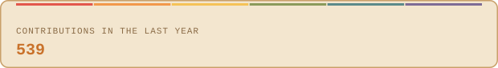
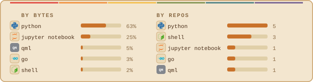
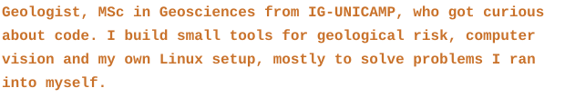

**[ak820-linux](https://github.com/hcristosm/ak820-linux)** &nbsp;·&nbsp; <samp>python, pyside6, pillow, hid, reverse engineering</samp>

**[ORCA](https://github.com/hcristosm/ORCA)** &nbsp;·&nbsp; <samp>python, geopandas, geopackage, typer, leaflet, chart.js, github actions, pytest</samp> &nbsp;·&nbsp; [dashboard ao vivo](https://hcristosm.github.io/ORCA/)

**[Videomonitoramento-de-encostas](https://github.com/hcristosm/Videomonitoramento-de-encostas)** &nbsp;·&nbsp; <samp>python, opencv, sam 2, dbscan, jupyter</samp>

**[dotfiles-cassette-futurism](https://github.com/hcristosm/dotfiles-cassette-futurism)** &nbsp;·&nbsp; <samp>kde plasma 6, qml, shell</samp>

